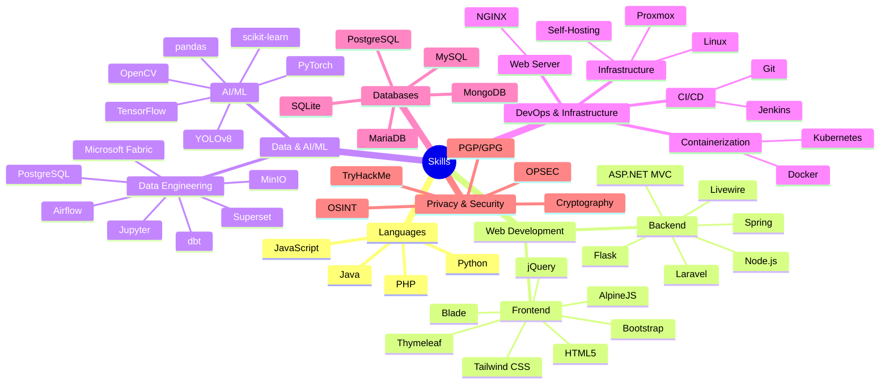

> [!IMPORTANT]
> **I've mostly stopped using GitHub.** I now use [my own Forgejo instance](https://git.sooox.cc/sooox).
> Also visit my website, [sooox.cc](https://sooox.cc/)

```
                                                                                              ╱|、
                                                                                            (˚ˎ 。7
                                                                                             |、˜〵
                                                                                             じしˍ,)ノ
```

<details>
<summary><b>Skills</b></summary>



</details>
